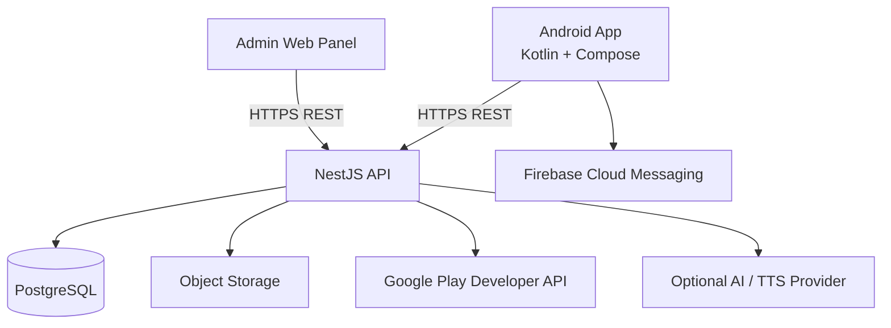

# Architecture — Indian Microlearning Platform

**Version:** 1.0  
**Status:** Task 1 foundation  
**Target:** Android-first microlearning MVP for India

## 1. Product boundary

The MVP consists of:
- Android learner application: Kotlin, Jetpack Compose, Material 3.
- Backend REST API: NestJS and TypeScript.
- Relational database: PostgreSQL through Prisma ORM.
- Admin web application: React/Next.js, subject to the agreed MVP implementation plan.
- Object storage for course images, audio and rendered lesson videos.
- Firebase Cloud Messaging for optional learning reminders.
- Google Play Billing with server-side purchase verification for Android subscriptions.

Initial learning paths: English Communication, Career and Workplace Skills, and Financial Literacy. English content may include Hindi/Hinglish explanations.

Explicitly out of scope for MVP: iOS, learner-facing web app, live AI voice conversations, real-time video calling, advanced 3D simulations, multiplayer/social feeds, and complex ML recommendations.

## 2. Architecture principles

1. API and database are the source of truth for published learning content, quiz scoring, XP, streaks and subscription entitlements.
2. Keep lessons as structured content in the backend; do not hardcode lesson copy in the Android app.
3. Separate content authoring from learner-facing delivery.
4. Use simple, maintainable modules; avoid premature microservices.
5. Validate all external input at API boundaries.
6. Make completion, quiz submission, XP awarding and billing event processing idempotent where duplicate requests are possible.
7. Keep media binaries in object storage; store metadata and references in PostgreSQL.
8. Design for low-to-mid-range Android devices and variable mobile connectivity.
9. Keep secrets on the server; never embed server-side provider secrets in the app.
10. Treat privacy, accessibility, observability and account deletion as product requirements.

## 3. High-level system



The AI/TTS provider is optional and should not be a critical dependency for the first release. The initial audio experience can use pre-generated media.

## 4. Repository strategy

For a small team and a constrained MVP budget, use a monorepo with clear application boundaries.

```text
indian-microlearning/
├── apps/
│   ├── android/             # Native Android app (Gradle project)
│   ├── api/                 # NestJS REST API
│   └── admin/               # Admin web panel
├── packages/
│   └── api-contracts/       # Shared API schemas/types only if practical
├── docs/
│   ├── architecture.md
│   ├── development-rules.md
│   ├── api-conventions.md
│   ├── data-model.md
│   └── adr/
├── infra/
│   ├── local/               # Local development configuration
│   └── deployment/          # Deployment scripts/configuration
├── .editorconfig
├── .gitignore
├── README.md
└── SECURITY.md
```

Android remains a standard Gradle project under `apps/android`. Do not force Kotlin/Gradle into the Node package manager workspace. Root scripts may orchestrate commands, but each app retains its native build tooling.

If monorepo tooling adds unnecessary setup overhead, keep the same logical boundaries while using a simple root folder and app-specific tooling.

## 5. Backend module boundaries

Suggested NestJS modules:

- `AuthModule`: identity integration, sessions/tokens, current-user endpoint.
- `UsersModule`: profile and account preferences.
- `LearningPathsModule`: learning-path discovery.
- `CoursesModule`: courses, modules and course metadata.
- `LessonsModule`: structured lesson content and progress.
- `QuizzesModule`: questions, attempts, scoring and answer explanations.
- `ProgressModule`: learning activity and progress summaries.
- `GamificationModule`: XP ledger, levels, streaks and achievements.
- `SubscriptionsModule`: products, purchase verification and entitlements.
- `NotificationsModule`: user preferences and notification dispatch.
- `MediaModule`: upload authorization and media metadata.
- `AdminModule`: administrative routes and role enforcement.
- `AnalyticsModule`: privacy-conscious product events and aggregates.
- `HealthModule`: readiness/liveness and dependency health checks.

These are logical modules, not separate services. Keep them in one deployable API for the MVP.

## 6. Android module boundaries

Start with a single Android app module unless build complexity proves a split is useful. Organize code by feature and shared core:

```text
apps/android/
└── app/src/main/
    ├── java/<package>/
    │   ├── app/             # Application class and app-level wiring
    │   ├── core/
    │   │   ├── network/
    │   │   ├── database/
    │   │   ├── datastore/
    │   │   ├── designsystem/
    │   │   ├── ui/
    │   │   └── common/
    │   ├── navigation/
    │   └── feature/
    │       ├── auth/
    │       ├── onboarding/
    │       ├── home/
    │       ├── explore/
    │       ├── course/
    │       ├── lesson/
    │       ├── quiz/
    │       ├── practice/
    │       ├── progress/
    │       ├── subscription/
    │       └── profile/
    └── res/
```

Within a feature, use UI/screen, ViewModel, domain models/use cases where they add value, and repository interfaces/implementations as appropriate. Do not create empty abstraction layers solely to follow a diagram.

## 7. Admin web boundaries

Suggested areas:
- Authentication and authorization.
- Dashboard.
- Learning path/course/module management.
- Lesson editor using a constrained block model.
- Quiz and question editor.
- Media metadata and upload workflow.
- Review/publish/archive workflow.
- Basic user/subscription overview.
- Basic analytics and audit log views.

Only authorized admin roles may publish content or view administrative data.

## 8. Data ownership and persistence

PostgreSQL is authoritative for:
- User profile and preferences.
- Published course and lesson definitions.
- Quiz definitions and server-verified results.
- Completion state and progress.
- XP transactions and achievements.
- Subscription entitlements.
- Admin roles and publication history.

Android local storage is for:
- Non-sensitive preferences.
- Cached content where useful.
- Limited resumable state where supported.
- Offline media metadata/cache references.

Local state must not be treated as authoritative for premium access, quiz scores, XP balances or streak calculations.

## 9. Content model direction

Use structured content blocks with a stable type and validated payload. Initial block types:
- `heading`
- `paragraph`
- `bullet_list`
- `callout`
- `image`
- `audio`
- `video`
- `example_conversation`
- `recap`

Quiz questions should be modeled separately where possible, rather than embedding all quiz logic inside arbitrary JSON. Use JSON only for genuinely flexible block payloads, and validate it against a versioned schema.

Content should support language variants without duplicating the identity of a course or lesson. Exact schema, enums, relations and indexes belong in Task 2.

## 10. Security and trust boundaries

- All protected API endpoints authenticate the caller.
- Admin authorization is enforced server-side.
- The API derives user identity from validated authentication, never from a client-supplied user ID alone.
- Purchase tokens are verified server-side with the applicable provider.
- Quiz scoring and XP are computed or verified server-side.
- Rate-limit login, OTP (if enabled), quiz submission and purchase verification.
- Never log access tokens, refresh tokens, passwords, purchase secrets or unnecessary personal data.
- Use signed/short-lived upload URLs where appropriate.
- Configure CORS narrowly for the admin web origin.
- Store secrets in environment/secret management, not source control.

## 11. Reliability and observability

- Structured logs with request/correlation IDs.
- Centralized API exception handling.
- Health/readiness endpoint.
- Crash and error reporting for Android and backend.
- Database backup and restore procedure.
- Metrics for API errors, latency, content load failures and billing verification failures.
- Explicit loading, empty, offline and error UI states.

## 12. Architecture decisions to record

Record material decisions in `docs/adr/` using:
- Context
- Decision
- Alternatives considered
- Consequences
- Date/status

Initial decisions:
1. Android-first native Kotlin/Compose.
2. Single NestJS API for MVP; no microservices.
3. PostgreSQL + Prisma as the relational persistence layer.
4. Backend-managed structured lesson content.
5. Pre-rendered media for first animation/video lessons.
6. Server-authoritative progress, XP and subscription entitlements.
